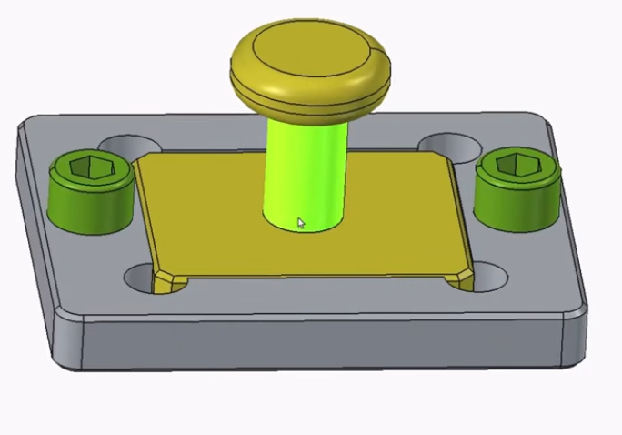
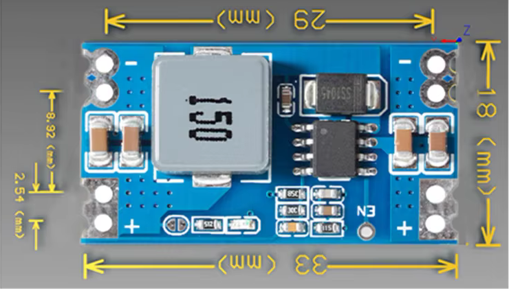

# Opgaver for 2026-2

## Nr.:1

### Lidt genopfriskning af tegne færdigheder

||||
|:---:|:---:|:---:|
||||

* [Mere om Opgave Nr.:1 ***Kik her***](./Opgave_2026-2_1.md)

## Nr.:2

### PieMenu Workbench

1. Se Videoen [Pie Menu](https://youtu.be/NveA_siC3GM "MangoJelly Solutions for FreeCA")
2. Brug Addon Manager til installation af PieMenu
3. Bliv fortrolig med PieMenu
   * [PieMenu Wiki](https://wiki.freecad.org/PieMenu_Workbench)

## Nr.:3

### Elements List, Wire Not Closed & Find Hidden Duplicate Geometry & Sketcher Constraints

1. Se Videoerne:
   * [How to Use the Elements List in FreeCAD Sketcher](https://youtu.be/BJ5LOMA8eew)
   * [FreeCAD Wire Not Closed? How to Find Hidden Duplicate Geometry The Easy Way](https://youtu.be/rlWq2DAD1is)
   * [FreeCAD Sketcher Constraints Tips & Tutorial](https://youtu.be/lAhzgE-jyvM)
2. Dokumentation:
   * [Sketcher Workbench](https://wiki.freecad.org/Sketcher_Workbench)
   * [Sketcher Preferences](https://wiki.freecad.org/Sketcher_Preferences)
3. Hent Opgave:
   * [Opgave_2026-2_3.FCStd](./Opgave_2026-2_3.FCStd)

## Nr.:4

### Import Images, Skaler Images og tegn komponentet

1. Se Videoerne:
   * [Why has the Image Workbench been removed in FreeCAD 0.21 / v1.0?](https://youtu.be/WhxDAgskcHA)
2. [Løs opgaven som beskrevet her](./Opgave_2026-2_4.md)

## Nr.:5

### Tegn komponent til KiCad

* 
* [Løs opgaven som beskrevet her](./Opgave_2026-2_5.md)

## Nr.:6

### Arbejde med pipe

* 
* [FreeCAD Part Design Pipe Along Multiple Planes / Sketches](https://youtu.be/jE-H_30MbcA "MangoJelly Solutions for FreeCAD")
* [FreeCAD File](./Opgave_2026-2_6.FCStd "Opgave_2026-2_6.FCStd")

#### Point Size

* point size kan sættes per sketch i:
  * Model -> View -> Object style -> Point size: 
    * default: 2
    * prøv: 10
* point size kan sættes for alle nye sketch i:
  * Edit -> Preferences -> Part/Part Design -> Shape Appearance
    * Vertex size: Default 2

|||
|:---:|:---:|
|||

## Nr.:6a

* [FreeCAD Multisection Sweep](https://youtu.be/9NTrz80ViVc?list=PLUrr_kHPp4vjkCWhqUy1KXkKevcXIHbaJ)
  * [FreeCad File: Opgave_2026-2_6b.FCStd](./Opgave_2026-2_6b.FCStd)
* [FREECAD:Pipe Routing, make FreeCAD do the work](https://youtu.be/fv53D00KdGQ "4 Axis Printing")
* [Make a Pipe Junction in FreeCAD](https://youtu.be/_IxO7IK4LT4 "Katt Kushol")
* [One FreeCAD Tool Solves a Common Pipe Modeling Problem](https://youtu.be/3A2R8FJpspM "MangoJelly Solutions for FreeCAD")
* [FreeCAD Tutorial: How to Connect Pipes with a Continuous Internal Holes](https://youtu.be/2nQ_SbFZc6M "MangoJelly Solutions for FreeCAD")
